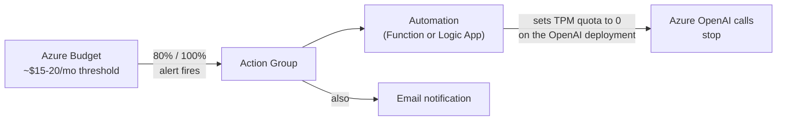

# ADR-0001: Reality-grounding layer for SpectrumHire's generators

- **Status:** Accepted. Hosting plan amended by [ADR-0004](0004-flex-consumption-hosting.md).
- **Date:** 2026-07-29 (ADR-0001i added 2026-07-31)
- **Deciders:** Bakari Holmes

## Context

SpectrumHire has three generators: interview rubrics, job descriptions, and interview-prep plans. They produce output from the base model's training knowledge plus whatever the user pastes in. Nothing pulls in real, current job-market data, so output can quietly drift from what companies actually post. Nothing reflects a specific company's stated values, mission, or culture either, which candidates and hiring teams both care about.

This project is also a deliberate learning vehicle: hands-on, production-style experience building and operating a RAG system on Azure (Azure OpenAI, Azure AI Search, Functions, Bicep) and with LangChain.

## Decision

Build **freshrubric**, a standalone project, separate from SpectrumHire's live Cloudflare Workers app (to be wired in only once proven), that:

1. **Ingests real, current job postings** on a schedule from public job board APIs.
2. **Ingests company values, mission, and culture context** alongside postings.
3. **Indexes both** so relevant context can be retrieved by role, company, or title.
4. **Grounds generation** in that retrieved context via RAG on Azure OpenAI, starting with the job description generator, then rubric, then interview prep.
5. **Returns citations** to the real postings each output was grounded in.
6. **Runs on Azure end to end**, with infrastructure as code, CI/CD, and real cost controls.

### ADR-0001a: Data sources: three public job board APIs, not scraping

Greenhouse, Lever, and Ashby's official public job board APIs. All three are sanctioned, no-auth public read endpoints, verified live against real boards:

- **Greenhouse Job Board API:** `GET https://boards-api.greenhouse.io/v1/boards/{board_token}/jobs?content=true`
- **Lever Postings API:** `GET https://api.lever.co/v0/postings/{site}`
- **Ashby Job Board API:** `GET https://api.ashbyhq.com/posting-api/job-board/{boardName}?includeCompensation=true`. This is the public posting API, not Ashby's separate API-key-gated recruiting API, which we are not using.

This avoids the legal and terms-of-service risk of scraping LinkedIn, Indeed, or Glassdoor, all of which actively contest scraping.

**Deferred:** firmographic enrichment (funding, headcount, industry). No free API covers it well, and v1 doesn't need it.

### ADR-0001b: Storage and indexing: Blob Storage + Azure AI Search indexer

Land raw and normalized postings in **Azure Blob Storage** as JSON. An **Azure AI Search indexer** (a pull-based crawler) reads the container, runs each document through a skillset that includes an Azure OpenAI embedding step, and writes a hybrid (keyword + vector) index. This is the standard Azure RAG pattern and avoids hand-written push-indexing code.

### ADR-0001c: Compute: Azure Functions (Python)

Timer-triggered functions for scheduled ingestion; an HTTP-triggered function for the grounded-generation endpoint.

*Amended by [ADR-0004](0004-flex-consumption-hosting.md): the Function App runs on the Flex Consumption plan.*

### ADR-0001d: RAG implementation: LangChain, deliberately

Use LangChain for the retrieval and generation chain. Use LangGraph only if a real multi-step control-flow need appears, not preemptively.

This is a conscious divergence from SpectrumHire's own architecture, which deliberately uses direct API calls with no framework. Here the goal includes building LangChain experience, so the tradeoff goes the other way.

### ADR-0001e: Infrastructure as code, CI/CD, and testing

- **Bicep** for provisioning, **GitHub Actions** for CI/CD, **Application Insights** for observability.
- **TDD by default.** Normalizers, HTTP retry and pagination, Blob idempotency, AI Search calls (behind a thin interface), and LangChain chain logic are unit-tested with pytest against mocks, fixtures, and Azurite. No live network or Azure account needed; this suite gates every PR.
- **A thin BDD layer.** 3–4 pytest-bdd feature files (~10 scenarios) describe end-to-end grounding behavior in Given/When/Then form. Kept deliberately small; it doubles as readable documentation. A 5th or 6th feature file is a signal it's sprawling into plain-pytest territory.
- **Live tests split by cost and risk:**
  - **Every PR:** three real job board fetches (Greenhouse, Lever, Ashby). Free and fast, and they catch upstream API shape changes immediately.
  - **Nightly only:** anything touching real Azure resources (Blob round-trip, AI Search round-trip, Azure OpenAI completion), since these cost money and need secrets.
  - **Plain-English explainer:** when something new, changed, or broken shows up, the nightly run summarizes what changed and why it matters, not just a stack trace.

### ADR-0001f: License and visibility

**Public repo, MIT license.** SpectrumHire remains the commercial product and stays closed. Because the repo is public, secrets management (`.env`, GitHub Actions secrets, `.gitignore`, no committed keys) is non-negotiable from the first commit.

### ADR-0001g: Cost ceiling and kill switch

Azure Budgets are alerts only. Per Microsoft's docs, resources aren't affected and consumption isn't stopped when a threshold is hit. A real ceiling has to be built.

**Free or near-free tiers by design:**

| Resource | Tier | Cost |
|---|---|---|
| AI Search | Free (F0) | $0, hard-capped (50 MB, 3 indexes) |
| Blob Storage | Standard | Pennies at this scale |
| Azure Functions | Flex Consumption plan, on-demand ([ADR-0004](0004-flex-consumption-hosting.md)) | Within the monthly free grant |
| Application Insights | Free data allowance | $0 at this scale |
| Key Vault | Pay per operation | Fractions of a cent |

**The one variable-cost surface is Azure OpenAI** (pay per token, no native hard cap). At personal scale this is cents, unless something runs away. Confirm current model pricing in the Azure pricing calculator before committing.

**Two independent layers of control:**

1. A deliberately low **deployment-level tokens-per-minute (TPM) quota** on the Azure OpenAI deployment, set from day one. This caps burn *rate*.
2. A **Budget → Action Group → Automation** chain that sets the TPM quota to 0 when spend nears the threshold (~$15–20/month). This caps total *spend*.

A function-level auth key on the HTTP generation endpoint is on from the start, so nobody else can find the endpoint and burn the budget.

### ADR-0001h: Company values, mission, and culture context

All three generators should ground in a company's stated values and culture, not just role requirements.

- **Primary source:** the "About [Company]" section already present in many job board postings. Free, reuses the ingestion pipeline, same sanctioned-API legitimacy. Limitation: not every posting has one, and it's often thin.
- **Secondary source (in v1):** a direct fetch of the company's own public careers or about/values page. This is not a sanctioned API, so these guardrails are v1 requirements:
  - Check `robots.txt` before every fetch; skip and log if disallowed.
  - Conservative per-domain rate limiting.
  - A clear `User-Agent` that identifies the bot and links to this repo.
  - Scoped to companies already in the ingestion seed list. No general-purpose crawling.
  - Graceful fallback to the primary source when a page can't be fetched or parsed cleanly.
  - A light freshness check that flags pages whose fetches start failing repeatedly.

### ADR-0001i: Decision process

How every decision in this ADR, and every future one, gets made:

- **Decisions are made by the maintainer in planning (Claude Code plan mode)**: architecture, coding style, linting rules, testing strategy, features and milestone scope, CI/CD design, and documentation strategy.
- **Implementation is AI-assisted.** It executes already-decided designs and conventions. If something undecided comes up mid-implementation, it goes back to planning instead of being decided inline.

Coding style and linting rules are deliberately left open here, to be decided in planning at Milestone 0.

## Consequences

- Hands-on experience with Azure OpenAI, Azure AI Search, Functions, Bicep, and LangChain, plus real cost governance (TPM quotas, budget automation).
- v1 scope is larger than a minimal version: three data sources, culture grounding, citations, and cost-ceiling automation. This trades a later v1 for a more complete and more honest result.
- Once proven, SpectrumHire's generators can be refreshed against real market data and real company context. Wiring it in is explicitly deferred.
- A deliberate divergence from SpectrumHire's no-framework approach, made for learning purposes.
- The careers-page fetch is the one data source that isn't a sanctioned API, so its guardrails must be built and tested from the start.
- ADR-0001i adds process, not scope: style and lint decisions get an explicit home at Milestone 0.

## Open questions

None on architecture or scope. Coding style and linting rules were decided at Milestone 0 in [ADR-0003](0003-python-toolchain-and-conventions.md).
