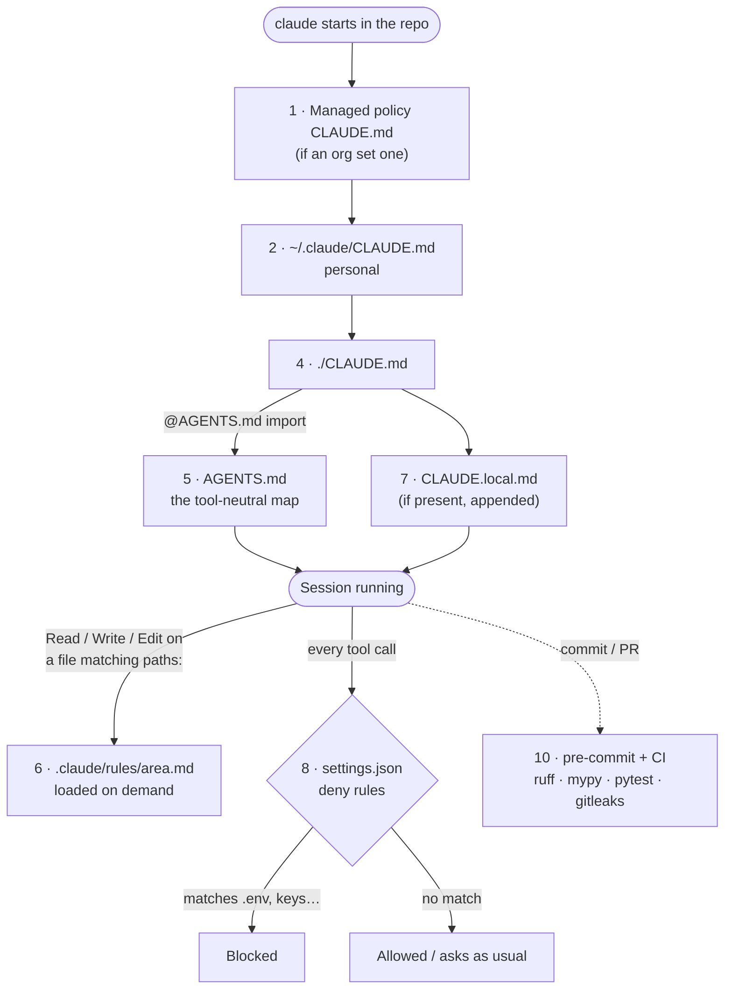

# Agent rules: where each instruction lives and when it loads

freshrubric is built with AI coding assistants under one rule: Bakari decides in planning, AI implements ([ADR-0001i](adr/0001-reality-grounding-layer.md#adr-0001i-decision-process)). This page maps every file that tells an assistant how to behave here: where it lives, who reads it, when it's loaded, and whether it's committed.

Load behavior below is quoted or paraphrased from the Claude Code docs as of 2026-11-18: [memory](https://code.claude.com/docs/en/memory), [permissions](https://code.claude.com/docs/en/permissions), [settings](https://code.claude.com/docs/en/settings), [hooks](https://code.claude.com/docs/en/hooks).

## The map

| # | File | Committed? | Read by | When it's loaded |
|---|---|---|---|---|
| 1 | Managed policy `CLAUDE.md` (macOS: `/Library/Application Support/ClaudeCode/CLAUDE.md`) | No (set by an organization) | Claude Code | At launch, first. This project doesn't use one. |
| 2 | `~/.claude/CLAUDE.md` | No (personal, every project) | Claude Code | At launch, after managed policy |
| 3 | `~/.claude/rules/*.md` | No (personal, every project) | Claude Code | Same timing as row 6. This project doesn't need any. |
| 4 | [`CLAUDE.md`](../CLAUDE.md) | Yes | Claude Code | At launch. It's `@AGENTS.md` plus a few Claude-only lines. |
| 5 | [`AGENTS.md`](../AGENTS.md) | Yes | Claude Code (through the import in row 4), the Copilot coding agent, and other agents that follow the AGENTS.md convention (Codex, Cursor) | At launch, expanded into `CLAUDE.md` by the import |
| 6 | [`.claude/rules/*.md`](../.claude/rules/) | Yes | Claude Code automatically. Other agents are told by AGENTS.md to read the matching file. | When Claude reads, writes, or edits a file matching the rule's `paths:` (including `cat` or `head` on a single file). Every rule here is path-scoped; a rule without `paths:` would load at launch. |
| 7 | `CLAUDE.local.md` | No (gitignored, not created) | Claude Code | At launch, appended after `CLAUDE.md` |
| 8 | [`.claude/settings.json`](../.claude/settings.json) | Yes | Claude Code | Enforced on every tool call: denies reading `.env`, `.env.*` (except `.env.example`), `local.settings.json`, `*.pem`, `*.key` |
| 9 | `.claude/settings.local.json` | No (gitignored) | Claude Code | Enforced on every tool call. Takes precedence over row 8 where both set the same value. |
| 10 | [`.pre-commit-config.yaml`](../.pre-commit-config.yaml), [`.github/workflows/ci.yml`](../.github/workflows/ci.yml) | Yes | git and GitHub Actions, for humans and agents alike | Every commit (pre-commit) and every PR (CI): ruff, mypy, pytest, gitleaks |
| 11 | [`docs/adr/`](adr/README.md) | Yes | Anyone, on demand | When a rule or AGENTS.md points to one. The rules link to ADRs instead of restating them. |

### The area rules (row 6)

| Rule | Loads when Claude touches | Source of truth |
|---|---|---|
| [`python-source.md`](../.claude/rules/python-source.md) | `src/**/*.py` | ADR-0003b, ADR-0001a, ADR-0001h |
| [`tests.md`](../.claude/rules/tests.md) | `tests/**` | ADR-0001e, ADR-0003c |
| [`dependencies.md`](../.claude/rules/dependencies.md) | `pyproject.toml`, `uv.lock` | ADR-0003e, ADR-0004, AGENTS.md |
| [`ci.md`](../.claude/rules/ci.md) | `.github/**` | ADR-0003f |
| [`adrs.md`](../.claude/rules/adrs.md) | `docs/adr/**` | AGENTS.md, ADR index |
| [`bicep.md`](../.claude/rules/bicep.md) | `**/*.bicep`, `**/*.bicepparam` | ADR-0001g, ADR-0004 |

Rules for individual data sources (normalizers, HTTP clients, the careers-page fetcher) come once M1/M2 name their subpackages. A rule can't point at a path that hasn't been decided.

## How it loads

Other agents (Copilot, Codex, Cursor) skip the Claude-specific steps: they read `AGENTS.md` directly, and AGENTS.md sends them to `.claude/rules/` for the area they're editing.

## Rules vs. enforcement

Rows 1–7 are **context**. Claude reads them and follows them, but nothing mechanically stops a mistake. The docs say so directly: "Claude treats them as context, not enforced configuration."

Rows 8–10 are **enforced**:

- **Settings deny rules** block Claude's built-in file tools and file commands Claude Code recognizes in Bash, such as `cat`, `head`, `tail`, `sed`, and `tee`. Deny is checked before ask and allow. The documented gap: they "don't apply to a command that reads files without naming them, such as `grep -r pattern .`… or to arbitrary subprocesses… like a Python or Node script that opens files itself." Closing that gap means OS-level sandboxing, which this repo doesn't configure.
- **pre-commit** (including gitleaks) blocks a commit locally, and **CI** blocks a merge. Both apply to humans and agents alike.

So "secrets never get committed" is written once in AGENTS.md and enforced in three places: the settings deny rules, gitleaks, and `.gitignore`.

## Demo script

Run these in a terminal in the repo.

1. **Check the version.** `claude --version`. Reading AGENTS.md without an import needs v2.1.277+, and `/context all` and `/doctor prompt-audit` are newer still. The `@AGENTS.md` import works on every version.
2. **Show what's wired in.** Start `claude` and run `/memory`. It lists the user and project memory files, including `~/.claude/CLAUDE.md` and `./CLAUDE.md`.
3. **Prove AGENTS.md is in context without a file read.** Run `/context all` (or `/context` on older versions) and look under **Memory files**. Then ask: *"Without opening any files, what does AGENTS.md say about secrets?"* Claude answers from context, with no Read tool call.
4. **Show why the import matters.** Run `git show 7867b59:CLAUDE.md`. The old CLAUDE.md only told Claude to read AGENTS.md, and the docs say that way "Claude sees AGENTS.md only if it decides to open the file."
5. **Trigger a path-scoped rule.** Ask: *"Which of the rules in .claude/rules are in your context right now?"* None of them should be. Then: *"Open tests/test_smoke.py."* Ask the first question again: `tests.md` has loaded because its `paths:` matched. Open `pyproject.toml` and `dependencies.md` loads the same way.
6. **Show enforcement.** In your own shell (not through Claude), run `printf 'DEMO=not-a-secret\n' > .env`. Then ask Claude to `cat .env`. The call is denied and the denial names the rule. Delete the file afterwards with `rm .env`.
7. **Show what's personal.** Run `git check-ignore -v CLAUDE.local.md .claude/settings.local.json .env`. Each one resolves to a `.gitignore` line.

To watch rules load live, Claude Code has an `InstructionsLoaded` hook. It fires when a CLAUDE.md or rule file loads, with reasons such as `session_start` and `path_glob_match`. It isn't configured in this repo.

## Adding or changing a rule

1. The content has to be decided already, in an ADR or AGENTS.md. A rule never makes a new decision; it points at one.
2. Create `.claude/rules/<area>.md` with `paths:` frontmatter matching only paths that exist or are decided. Keep it to a handful of lines and link the ADR.
3. Add it to the area-rules table above.
