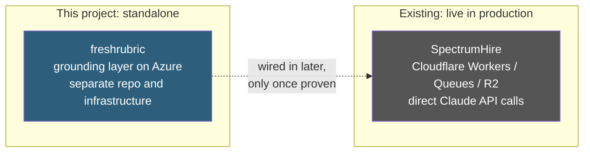
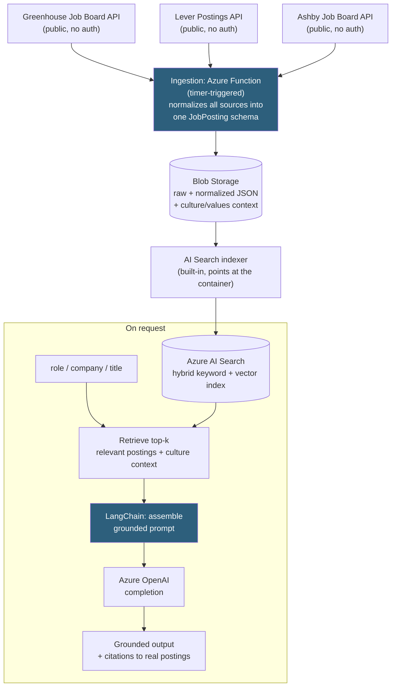
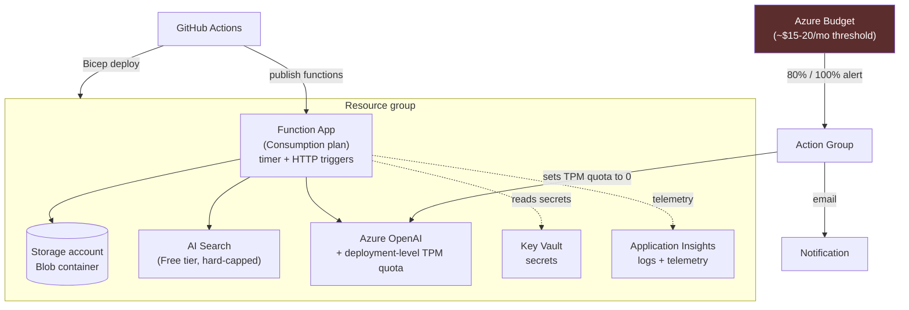
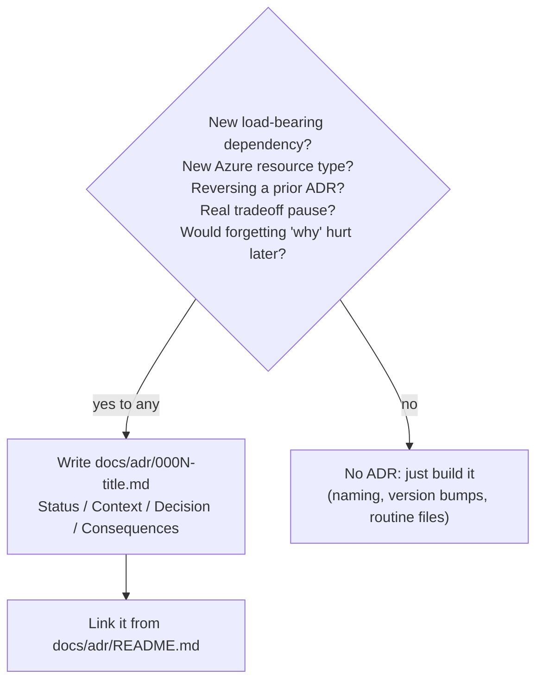

# Architecture walkthrough

What each part of freshrubric is, why it's shaped this way, and how the pieces fit. [ADR-0001](adr/0001-reality-grounding-layer.md) and [ADR-0002](adr/0002-drift-detection-agent-swarm.md) are the authoritative decision records; this doc is the guided tour.

> **Status:** design only. Nothing below is built yet. See the [roadmap](roadmap.md).

## 1. Where this sits

**Why separate:** SpectrumHire is a live product with its own architecture. Keeping freshrubric standalone means it can be built and experimented with on Azure, including getting things wrong, with no risk to the live product. Integration is a future step, not part of this build.

## 2. Data flow: how a real posting becomes a grounded, cited answer

**Why this shape:**

- **Blob → AI Search indexer** instead of hand-written indexing code: the standard Azure RAG pattern, with little custom code.
- **Three sources** (Greenhouse, Lever, Ashby), all sanctioned public APIs, not scraping (ADR-0001a).
- **Normalize at the edge:** each source maps to one schema, so a fourth job board only touches ingestion.
- **Culture context, not just requirements:** primarily the "About [Company]" section in postings; secondarily a guardrailed fetch of the company's own careers page (ADR-0001h).
- **Citations in the output:** they're what make "grounded" verifiable instead of a claim.

ADR-0002 adds a second flow alongside this one: a drift-detection agent swarm that watches the same index over time and proposes generator updates for human review.

## 3. Azure resource map

**Why Bicep + GitHub Actions:** standing an environment up reproducibly from code, and tearing it down cleanly to control cost, is the real skill, not clicking through the portal once.

**A real cost ceiling (ADR-0001g):** Azure Budgets only alert; they don't stop consumption. Two independent layers do: a low Azure OpenAI tokens-per-minute quota from day one (caps burn rate), and budget automation that sets that quota to 0 near the threshold (caps total spend). Everything else is free or near-free at this scale by design.

## 4. Testing strategy: TDD by default, a thin BDD layer on top

```mermaid
graph TD
    subgraph "Every PR: fast, mocked, plus one cheap live check"
        T1["Normalizers<br/>(each source → common schema)"]
        T2["HTTP client retry / pagination<br/>(mocked)"]
        T3["Blob idempotency<br/>(Azurite emulator)"]
        T4["AI Search calls<br/>(in-memory fake behind a thin interface)"]
        T5["LangChain chain logic<br/>(fake LLM + fake embeddings)"]
        T6["3 real job board fetches<br/>(free, fast, catch upstream changes)"]
    end

    subgraph "Nightly: real Azure resources"
        L1["Blob round-trip"]
        L2["AI Search round-trip"]
        L3["Azure OpenAI completion"]
        L4["Plain-English 'what changed and why' summary"]
    end

    subgraph "Acceptance: pytest-bdd, capped at 3-4 features"
        B1["Given a board with N postings,<br/>when ingestion runs,<br/>then the index has N documents"]
        B2["Given real postings exist,<br/>when a grounded rubric is requested,<br/>then the output cites a real posting"]
    end

    T1 & T2 & T3 & T4 & T5 & T6 -->|"gates every merge"| CI["GitHub Actions: PR check"]
    L1 & L2 & L3 & L4 -->|"costs money / needs secrets"| NIGHT["GitHub Actions: nightly"]
    B1 & B2 -->|"living documentation"| CI
```

Most of this project is deterministic transformation logic and infrastructure I/O, which unit tests handle well. BDD gets a narrow place because a few Given/When/Then scenarios double as documentation anyone can read.

## 5. ADR discipline

## 6. Decision process

Decisions (architecture, style, linting, testing, features, CI/CD, docs) are made in planning and recorded here. AI-assisted coding implements decided designs and stops to ask when something isn't decided. See [AGENTS.md](../AGENTS.md) and ADR-0001i.
